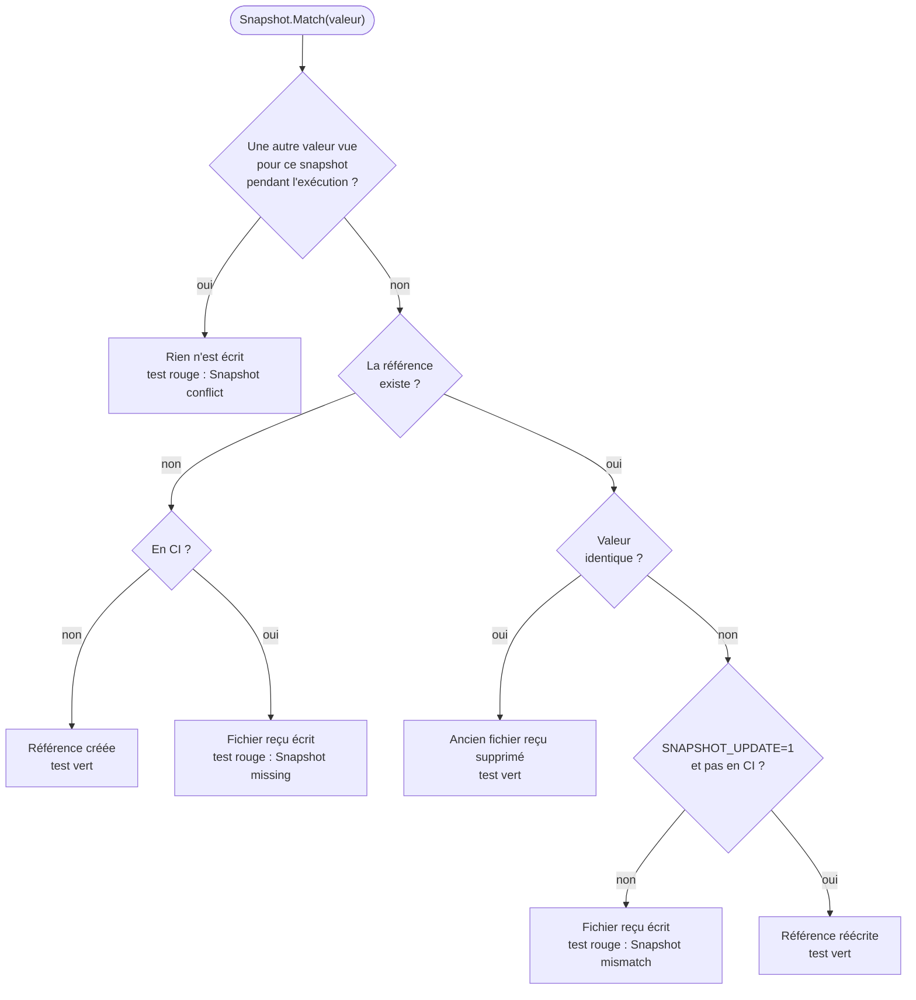

# Cycle de vie d'un snapshot

Cette page explique ce que fait Carbonite à chaque exécution, sur votre poste et en CI, comment lire un échec et comment accepter un changement.

Rappel du vocabulaire : la **référence** est le fichier `*.verified.json` (ou `.txt`) committé dans `__snapshots__` ; le **fichier reçu** est le fichier `*.received.json` (ou `.txt`) écrit à côté quand la valeur diffère.

## En un coup d'œil

| Situation | Sur votre poste | En CI |
| --- | --- | --- |
| La référence n'existe pas | Elle est créée, le test passe. | Le test échoue (`Snapshot missing`) et la valeur part dans un fichier reçu. Aucune référence n'est créée. |
| La valeur est identique | Le test passe. Un ancien fichier reçu est supprimé. | Le test passe. |
| La valeur est différente | Le test échoue avec un diff (`Snapshot mismatch`). La valeur part dans un fichier reçu. | Pareil. |
| La valeur est différente et `SNAPSHOT_UPDATE=1` | La référence est réécrite, le test passe. | La variable est ignorée : le test échoue avec le diff et une note. |
| Une autre valeur a déjà été vérifiée contre ce snapshot pendant l'exécution | Le test échoue (`Snapshot conflict`), quel que soit le fichier. Rien n'est écrit. | Pareil. |

## Le schéma



Le schéma laisse de côté un cas rare, le changement de format, décrit [plus bas](#le-format-a-changé).

## 1. La référence n'existe pas

**Sur votre poste**, Carbonite crée la référence et le test passe. La sortie standard du test le signale :

```text
Carbonite created the snapshot /src/carbonite/samples/Sample.Facturation.Tests/__snapshots__/FactureTests.Une_facture_complete.verified.json. Review it before committing it.
```

Relisez le fichier, puis committez-le avec le test.

**En CI**, Carbonite ne crée jamais de référence. Le test échoue, et la valeur est écrite dans un fichier reçu pour que vous puissiez la consulter :

```text
Snapshot missing: FactureTests.Une_facture_complete

There is no verified snapshot at /src/carbonite/samples/Sample.Facturation.Tests/__snapshots__/FactureTests.Une_facture_complete.verified.json.
On continuous integration, Carbonite never creates snapshots: a missing snapshot usually means that it was not committed.
Run the tests on your machine, review the new file in __snapshots__, then commit it.

The received value was written to /src/carbonite/samples/Sample.Facturation.Tests/__snapshots__/FactureTests.Une_facture_complete.received.json.
```

Pourquoi ce refus : si la CI créait la référence, elle enregistrerait n'importe quelle valeur, même fausse, et le test passerait sans rien vérifier.

## 2. La valeur est identique

Le test passe. Si un fichier reçu traînait à côté de la référence (un échec précédent), Carbonite le supprime.

La comparaison se fait caractère par caractère, après avoir mis les deux textes sous la même forme. Elle ignore :

- la marque d'ordre des octets (BOM) UTF-8 en début de fichier ;
- les fins de ligne Windows : `\r\n` vaut `\n` ;
- les sauts de ligne à la fin du fichier.

Elle n'ignore pas les espaces en fin de ligne, les tabulations ni les espaces insécables : ils font partie de la valeur.

Carbonite écrit ses fichiers en UTF-8 sans BOM, avec des fins de ligne `\n` et un saut de ligne final. Il passe par un fichier temporaire puis le renomme : un test interrompu ne laisse jamais une référence à moitié écrite. Si deux tests, ou deux processus, créent la même référence au même moment, un seul l'écrit ; l'autre compare sa valeur à ce fichier.

## 3. La valeur est différente

Le test échoue. Carbonite écrit la nouvelle valeur dans un fichier reçu, à côté de la référence, et lève une `SnapshotMismatchException` dont le message contient un diff.

Exemple réel : dans `UneFacture()`, le prix de la lampe de bureau passe de `39.50m` à `42.00m`. Le test `Une_facture_complete` échoue avec ce message :

```text
Snapshot mismatch: FactureTests.Une_facture_complete

The value is different from the verified snapshot.

--- verified
+++ received
@@ -14,12 +14,12 @@
     {
       "Libelle": "Lampe de bureau",
       "Quantite": 1,
-      "PrixUnitaireHt": 39.50,
-      "TotalHt": 39.50
+      "PrixUnitaireHt": 42.00,
+      "TotalHt": 42.00
     }
   ],
   "TauxDeTva": 0.20,
-  "TotalHt": 339.30,
-  "Tva": 67.86,
-  "TotalTtc": 407.16
+  "TotalHt": 341.80,
+  "Tva": 68.36,
+  "TotalTtc": 410.16
 }

Verified: /src/carbonite/samples/Sample.Facturation.Tests/__snapshots__/FactureTests.Une_facture_complete.verified.json
Received: /src/carbonite/samples/Sample.Facturation.Tests/__snapshots__/FactureTests.Une_facture_complete.received.json

If the new value is correct, accept it, then review the change in your pull request:
  - replace the verified file with the received file, or
  - run the tests again with SNAPSHOT_UPDATE=1:
      bash, zsh:   SNAPSHOT_UPDATE=1 dotnet test
      PowerShell:  $env:SNAPSHOT_UPDATE=1; try { dotnet test } finally { Remove-Item Env:SNAPSHOT_UPDATE }
```

Comment le lire :

| Partie du message | Sens |
| --- | --- |
| `Snapshot mismatch: FactureTests.Une_facture_complete` | Le snapshot concerné, sans le dossier ni l'extension. |
| `--- verified` / `+++ received` | Les lignes qui commencent par `-` viennent de la référence, celles qui commencent par `+` de la nouvelle valeur. |
| `@@ -14,12 +14,12 @@` | Le passage montré commence à la ligne 14 et couvre 12 lignes de chaque côté. |
| Lignes qui commencent par un espace | Le contexte : trois lignes inchangées autour de chaque écart. |
| `Verified:` / `Received:` | Les chemins complets de la référence et du fichier reçu. |
| La fin du message | Les deux façons d'accepter la nouvelle valeur. |

Au-delà de 80 lignes, le diff est coupé et se termine par `... N more diff lines`. Si les parties qui diffèrent sont trop grandes pour un diff ligne à ligne (des milliers de lignes de chaque côté), le message montre seulement la première ligne qui diffère (`First difference at line N:`). Ouvrez alors le fichier reçu.

Le message peut ajouter une note avant les chemins :

| Note | Sens |
| --- | --- |
| `Note: the only differences are whitespace (spaces, tabs or line breaks).` | Les lignes semblent identiques : un espace, une tabulation, un saut de ligne ou un espace insécable a changé. Voir [Dépannage](depannage.md#les-lignes-du-diff-semblent-identiques). |
| `Note: SNAPSHOT_UPDATE is ignored on continuous integration: snapshots are only updated on a developer machine.` | Vous avez demandé une mise à jour en CI. Voir [plus bas](#5-en-ci-snapshot_update-est-ignoré). |

## 4. Accepter un changement

Un écart n'est pas forcément un bug : c'est peut-être le changement que vous venez de coder. Relisez le diff. Si la nouvelle valeur est la bonne, acceptez-la d'une de ces deux façons.

### Relancer les tests avec SNAPSHOT_UPDATE=1

Avec bash ou zsh, la variable ne vaut que pour cette commande :

```bash
SNAPSHOT_UPDATE=1 dotnet test
```

Avec PowerShell, la variable resterait définie pour toute la session : tant qu'elle existe, chaque `dotnet test` réécrit les références qui diffèrent. Cette forme la retire, même si les tests échouent :

```powershell
$env:SNAPSHOT_UPDATE=1; try { dotnet test } finally { Remove-Item Env:SNAPSHOT_UPDATE }
```

Carbonite accepte les valeurs `1`, `true`, `yes` et `on`, sans tenir compte de la casse. Toute autre valeur est ignorée.

En mode mise à jour, sur votre poste :

- chaque référence dont la valeur diffère est réécrite, dans tous les tests exécutés, et le test passe ;
- la sortie standard du test indique `Carbonite updated the snapshot <chemin>.` ;
- les fichiers reçus sont supprimés ;
- une référence dont la valeur n'a pas changé n'est pas touchée ;
- une référence absente est créée, comme d'habitude.

Pour ne mettre à jour que quelques tests, limitez l'exécution avec le filtre de votre framework de test (exemple TUnit dans [TUnit](tunit.md#mettre-à-jour-les-snapshots-de-quelques-tests)).

### Remplacer la référence par le fichier reçu

Pratique pour accepter un seul snapshot, ou une valeur récupérée dans les artefacts de la CI.

Avec bash ou zsh :

```bash
cd samples/Sample.Facturation.Tests/__snapshots__
mv FactureTests.Une_facture_complete.received.json FactureTests.Une_facture_complete.verified.json
```

Avec PowerShell :

```powershell
cd samples/Sample.Facturation.Tests/__snapshots__
Move-Item -Force FactureTests.Une_facture_complete.received.json FactureTests.Une_facture_complete.verified.json
```

### Un test qui contient plusieurs snapshots

`Snapshot.Match` lève une exception au premier écart : le test s'arrête là, et les snapshots suivants du même test ne sont pas vérifiés pendant cette exécution.

Dans l'exemple, le changement de prix touche les deux snapshots de `Une_facture_avant_et_apres_remise`, mais seul `avant-remise` est signalé. `apres-remise` le sera à l'exécution suivante. `SNAPSHOT_UPDATE=1` traite les deux d'un coup, car il ne s'arrête pas au premier écart. Avec TUnit, l'assertion `MatchesSnapshot()` dans un bloc `Assert.Multiple()` signale tous les écarts en une fois (voir [TUnit](tunit.md#avec-assertmultiple)).

## 5. En CI, SNAPSHOT_UPDATE est ignoré

En CI, Carbonite ne réécrit jamais une référence, même avec `SNAPSHOT_UPDATE=1`. Le test échoue avec le diff habituel, plus cette note :

```text
Note: SNAPSHOT_UPDATE is ignored on continuous integration: snapshots are only updated on a developer machine.
```

Pourquoi : une mise à jour en CI accepterait la nouvelle valeur sans que personne ne la relise. La relecture se fait dans la pull request. La liste des variables qui signalent la CI est dans [CI](ci.md).

## 6. Cas particuliers

### Le format a changé

Une chaîne est enregistrée dans un fichier `.verified.txt`, toute autre valeur dans un `.verified.json`. Si la valeur change de nature, la référence existe, mais avec l'autre extension. Par exemple, si `CourrielDeConfirmation` renvoyait un objet au lieu d'une chaîne :

```text
Snapshot format changed: FactureTests.Le_courriel_de_confirmation

The verified snapshot is /src/carbonite/samples/Sample.Facturation.Tests/__snapshots__/FactureTests.Le_courriel_de_confirmation.verified.txt, but the value is now an object, stored as JSON in FactureTests.Le_courriel_de_confirmation.verified.json.
If this change is intended, delete /src/carbonite/samples/Sample.Facturation.Tests/__snapshots__/FactureTests.Le_courriel_de_confirmation.verified.txt, or run the tests again with SNAPSHOT_UPDATE=1 to replace it.
```

Si le changement est voulu, supprimez l'ancienne référence : le passage suivant crée la nouvelle. Ou relancez avec `SNAPSHOT_UPDATE=1` : Carbonite écrit la nouvelle référence, puis supprime l'ancienne.

### Deux valeurs pour un même snapshot

Pendant une exécution, Carbonite retient la première valeur vérifiée pour chaque snapshot. Si une autre valeur, différente, vise le même fichier, c'est presque toujours une erreur de nommage : un test paramétré sans nom de cas, une boucle, une méthode utilitaire partagée. Ou bien la valeur n'est pas déterministe.

Ce contrôle passe **avant** la lecture du fichier : la seconde valeur échoue toujours, même si elle correspond à la référence, et même en mode mise à jour. Sinon, selon l'ordre des cas, le problème n'apparaîtrait qu'une fois sur deux. Le message montre les deux valeurs :

```text
Snapshot conflict: FactureTests.Le_total_suit_la_quantite

This snapshot was already checked earlier in this run with a different value (the first one by FactureTests.Le_total_suit_la_quantite). One snapshot file cannot hold both, and SNAPSHOT_UPDATE cannot choose between them.

--- first value
+++ this value
@@ -1,5 +1,5 @@
 {
-  "TotalHt": 39.50,
-  "Tva": 7.90,
-  "TotalTtc": 47.40
+  "TotalHt": 118.50,
+  "Tva": 23.70,
+  "TotalTtc": 142.20
 }

If the test is parameterized, or calls Snapshot.Match in a loop or from a shared helper, give each value its own name, for example Snapshot.Match(value, $"case-{id}"). Otherwise the value is not deterministic: hide what changes with options.IgnoreMember or options.ScrubMember.
```

La correction : donner un nom à chaque valeur. Voir [Autres frameworks](autres-frameworks.md#tests-paramétrés--un-nom-par-cas) ; avec TUnit, les cas paramétrés sont nommés automatiquement.

Deux noms qui ne diffèrent que par la casse sont refusés de la même façon, même avec des valeurs identiques : Windows et macOS n'y voient qu'un seul fichier, Linux en voit deux.

```text
Snapshot name conflict: FactureTests.Calcule.total.verified.json

The snapshot names FactureTests.Calcule.Total.verified.json and FactureTests.Calcule.total.verified.json differ only by letter case. Windows and macOS see a single file where Linux sees two, so the snapshots would overwrite each other.
Rename one of the tests or snapshots (the name argument of Snapshot.Match).
```

## 7. Relire un snapshot dans une pull request

Le diff des fichiers `.verified.*` est la relecture du changement. Quelques réflexes :

- **Un fichier ajouté** : relisez-le comme une assertion écrite à la main. Le premier passage enregistre la valeur telle quelle, juste ou fausse.
- **Un fichier modifié** : chaque ligne qui change est un changement de comportement. Est-il voulu ? Correspond-il au ticket ?
- **Un marqueur qui change** (`Guid_1` qui devient `Guid_2`) : une relation entre valeurs a changé, par exemple une facture qui ne pointe plus vers le même client, ou un nouveau Guid apparaît plus haut dans le fichier.
- **Beaucoup de fichiers modifiés sans raison apparente** : suspectez une valeur instable, la culture de la machine ou un ordre non déterministe (voir [Dépannage](depannage.md)).
- **Un test renommé ou supprimé** : Carbonite ne supprime jamais une référence orpheline. Supprimez l'ancien fichier dans la même pull request.
- **Un fichier `.received.*`** : il n'a rien à faire dans la pull request. Ajoutez `*.received.*` au `.gitignore` (voir [Démarrage](demarrage.md#régler-git-et-léditeur)).

## Les exceptions

| Exception | Quand |
| --- | --- |
| `SnapshotMismatchException` | La valeur diffère de la référence. Ses propriétés `VerifiedFilePath` et `ReceivedFilePath` donnent les deux chemins. |
| `SnapshotException` | Le snapshot ne peut pas être vérifié : référence absente en CI, format changé, conflit, valeur refusée (`Task` sans `await`, structure sans fin…), fichier de test introuvable, référence qui n'est pas en UTF-8. Le message dit toujours quoi faire. |

`SnapshotMismatchException` hérite de `SnapshotException`. Avec l'assertion TUnit `MatchesSnapshot()`, ces erreurs deviennent des échecs d'assertion TUnit, avec le même texte.

---

Voir aussi : [TUnit](tunit.md) · [CI](ci.md) · [Dépannage](depannage.md).
